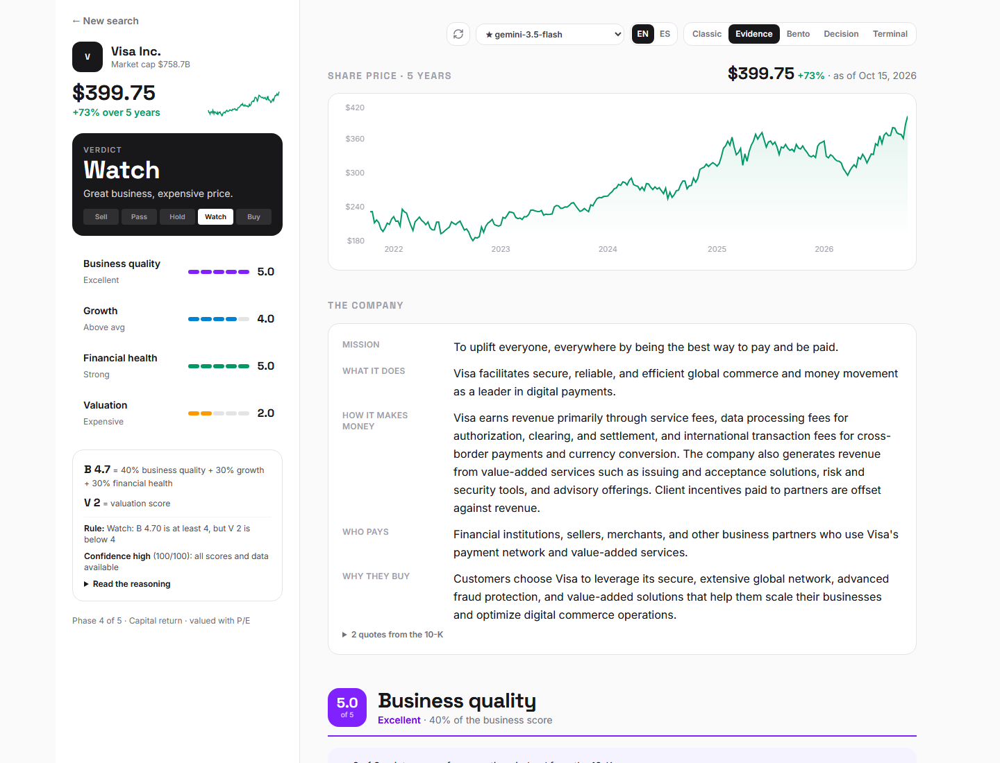
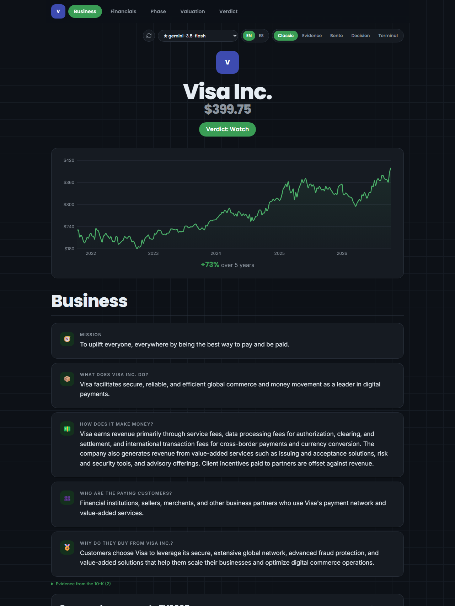
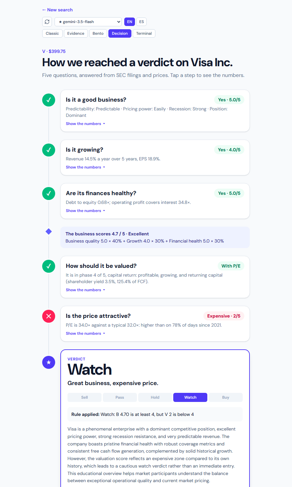
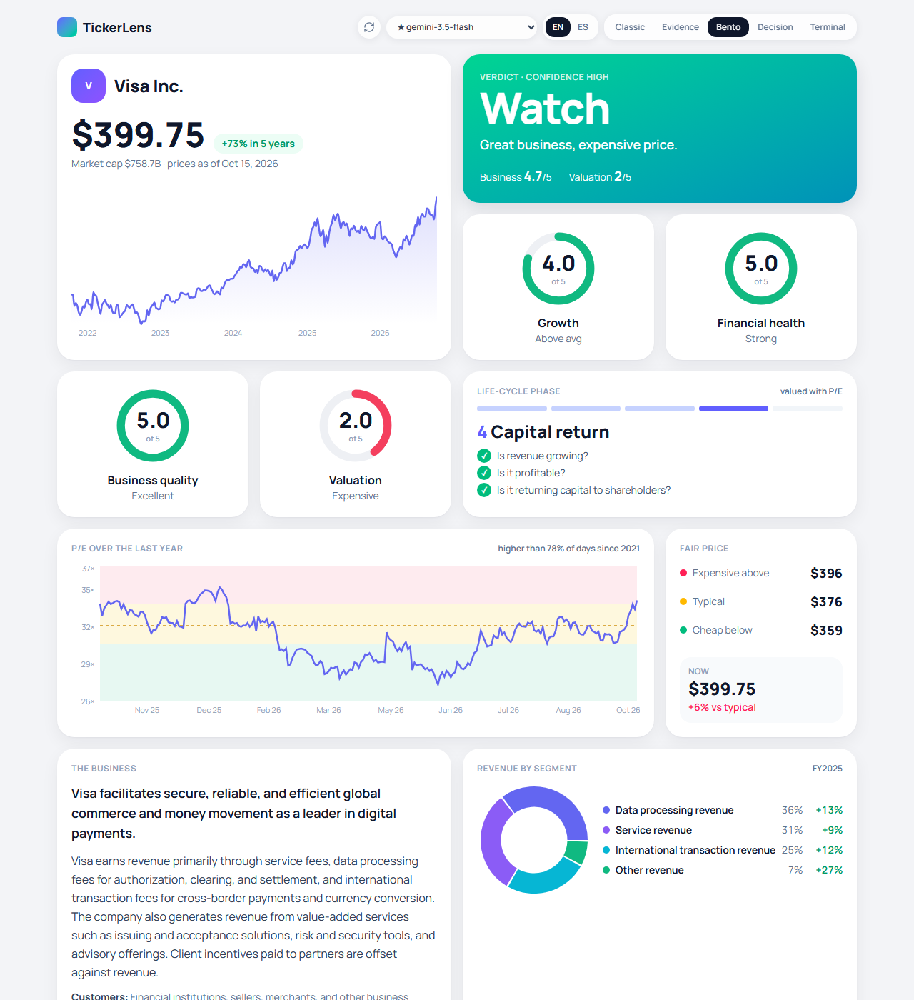
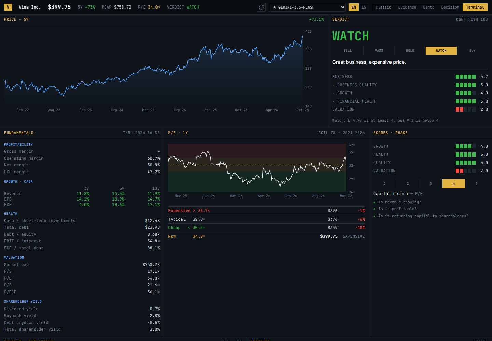
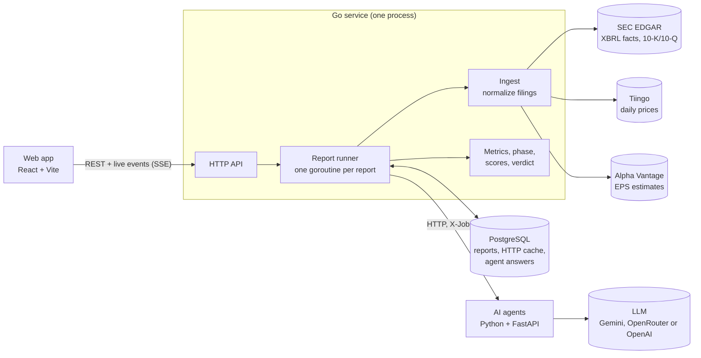

# TickerLens

[](https://github.com/YLaguna506/tickerlens/actions/workflows/ci.yml)

Type a US ticker and TickerLens builds a research report from the company's SEC filings and price history: what the business does, how good it is, how it has grown, how healthy it is, what a fair price looks like, and a **Sell / Pass / Hold / Watch / Buy** verdict that explains itself.

> **Educational project. Not financial advice.** Nothing here is a recommendation to buy or sell any security.



## What's in a report

Every report has the same data, shown in five designs you can switch between at the top of the page. Next to the design switch:

- **English / Español.** The whole page switches language, including every computed explanation (score reasons, rules, formulas). Reports themselves are built in a language: in Spanish, the AI agents write their prose in Spanish while quotes stay word for word from the filing. Switching on an open report offers to build it in the other language.
- **AI model.** Pick the model for new reports from the ones your keys allow (the default, its fallback, each provider's configured model and anything in `LLM_MODEL_CHOICES`). An open report keeps the model it was built with.
- **↻** deletes the ticker's saved reports and cached data and builds a fresh one.

| Design | Idea |
|---|---|
| **Classic** | One long page in a dark theme: Business, Financials, Phase, Valuation, Verdict |
| **Evidence** | The verdict and its four scores stay pinned; the data is grouped by the score it feeds (above) |
| **Bento** | A grid of tiles: rings for scores, charts, segments, earnings |
| **Decision** | The verdict as a chain of questions, each opening to its numbers |
| **Terminal** | Dark and dense, everything on one screen |

<table>
  <tr>
    <td></td>
    <td></td>
  </tr>
  <tr>
    <td></td>
    <td></td>
  </tr>
</table>

- **Business:** mission, what the company does, how it makes money, who pays and why, with quotes from the 10-K; revenue by segment and region with year-over-year change.
- **Business quality:** four questions (predictable revenue? pricing power? recession-proof? competitive position?), each answered with a justification and filing quotes.
- **Financials:** margins, 3/5/10-year growth, debt and coverage, valuation multiples, shareholder yield, EPS against analyst estimates. Tap any number to see its formula and inputs.
- **Phase:** where the company is in its life cycle (startup → hypergrowth → operating leverage → capital return → decline), which picks the right valuation multiple.
- **Valuation:** today's multiple against its own 5-year history, translated into cheap / typical / expensive share prices.
- **Verdict:** the rule that matched, the scores behind it, a confidence level, and a short AI-written summary.

## Architecture



A report moves through four stages, and the page updates live after each one:

1. **Ingesting:** fetch SEC company facts, the latest filings, prices and estimates (cached in Postgres, rate limited, retried).
2. **Computing:** normalize the financials and compute every metric, the phase, and the growth, health and valuation scores.
3. **Analyzing:** the AI agents read Items 1 and 7 of the latest 10-K.
4. **Scoring:** apply the verdict rules, then ask the narrative agent to summarize them.

| Layer | Tech |
|---|---|
| API, pipeline, metrics | Go (stdlib HTTP, pgx, slog, errgroup) |
| AI agents | Python 3.12, FastAPI, Pydantic, httpx |
| Storage and cache | PostgreSQL 16 |
| Frontend | React 19, Vite, TypeScript, Tailwind, Recharts, TanStack Query |
| Local stack | Docker Compose, Taskfile, GitHub Actions |

## Getting started (about 10 minutes)

You need [Docker Desktop](https://www.docker.com/products/docker-desktop/) and [Task](https://taskfile.dev/installation/) (`winget install Task.Task` on Windows, `brew install go-task` on macOS).

1. **Clone and run `task up` once.** It creates `.env` from `.env.example` and stops, asking for your keys:

   ```bash
   git clone https://github.com/YLaguna506/tickerlens.git
   ```

   ```bash
   cd tickerlens
   ```

   ```bash
   task up
   ```

2. **Add your keys to `.env`** (all free):

   | Variable | What for | Get it |
   |---|---|---|
   | `SEC_USER_AGENT` | SEC asks every client to identify itself: `TickerLens your@email.com` | no sign-up |
   | `TIINGO_API_KEY` | Daily prices | [tiingo.com](https://www.tiingo.com/account/api/token) |
   | `GEMINI_API_KEY` | The AI agents | [Google AI Studio](https://aistudio.google.com/apikey) |
   | `ALPHA_VANTAGE_API_KEY` | EPS vs estimates (optional) | [alphavantage.co](https://www.alphavantage.co/support/#api-key) |

3. **Start again** with the keys:

   ```bash
   task up
   ```

4. Open **http://localhost:3000**, type a ticker (try `V`, `AAPL` or `MSFT`) and watch the report build.

Tested from a fresh clone: the stack builds in under a minute (plus downloading base images the first time) and a first Apple report took about a minute on Gemini's free tier, mostly the AI step. The free tier allows about 20 requests a day per model and a report uses 4–6, so `LLM_FALLBACK_MODEL` takes over when the main model is busy or out of quota. Asking for the same ticker again within 12 hours returns the saved report instantly. Without an LLM key you still get every number, score and the verdict, just no AI sections.

| Service | URL |
|---|---|
| Web app | http://localhost:3000 |
| API health | http://localhost:8080/healthz |
| Agents health | http://localhost:8000/healthz |

Stop everything with `task down`. Run `task --list` to see every task.

## Design decisions

### Numbers are computed, never generated

Every figure comes from source data and is calculated in Go: margins, growth rates, multiples, scores and the verdict itself. The LLM only reads the 10-K, answers judgment questions and writes the closing summary. That keeps every number reproducible (the CLI prints the same ones) and testable against golden files.

The financials follow a few strict rules: the most recently filed value wins (so restatements count); quarters only reported as year-to-date totals are derived by subtraction and labeled as derived; per-share values are converted to today's share terms using the split history; anything that can't be found or derived stays empty instead of being guessed.

### How hallucinations are kept out

Each agent's answer must pass these checks before it's accepted:

1. **Schema:** the reply must match a strict JSON schema.
2. **Quotes:** every judgment cites a quote that must appear **word for word** in the filing.
3. **Number guard:** every number in the prose must match a computed metric or a number inside the agent's own quotes, at the precision written. An invented figure fails.
4. **Segments:** each figure must appear in a quote, and the segments must roughly add up to reported revenue.

A failed check gets one repair attempt, where the agent is told exactly what was wrong. If that fails too, the section is left out and the report is marked partial. `task eval` runs the agents on 10 companies and checks their answers against expected results.

### The verdict is a rule, not a model

1. **Business score (B):** business quality 40%, growth 30%, financial health 30% (reweighted if one is missing).
2. **Valuation score (V):** where today's multiple sits in its own 5-year history.
3. **Rules,** first match wins:

| Verdict | Rule | Meaning |
|---|---|---|
| **Sell** | B < 2.5, or B < 3.0 and V ≤ 2 | Weak business, or a mediocre one that is expensive |
| **Buy** | B ≥ 4.0 and V ≥ 4, or B ≥ 3.5 and V = 5 | Strong business at an attractive price |
| **Watch** | B ≥ 4.0 | Great business; wait for a better price |
| **Hold** | B ≥ 3.0 and V ≥ 3 | Solid business at a fair price |
| **Pass** | anything else | Not compelling at this price |

Every threshold and weight lives in [`config/scoring.yaml`](config/scoring.yaml). Edit it and restart the API (`docker compose restart api`); the file's version is stored on every report. Example: Visa scores B 4.7 (quality 5, growth 4, health 5) and V 2, so its verdict is **Watch**.

A multiple's own history is only a fair yardstick if what it divides by was stable. When EPS or free cash flow collapsed during the 5 years (Salesforce's EPS fell to $0.21 in 2022, which made its "typical" P/E 68×), the report switches to the next multiple and says why.

### Why there's no queue

This is a personal research tool: one user, a handful of reports a day. A report runs in a goroutine inside the API process, its progress is pushed to the page over Server-Sent Events, and its state lives in a Postgres row. What a queue would buy (retries across restarts, many workers) isn't needed yet, so the stack keeps only what pays for itself: retries with backoff that honor `Retry-After`, timeouts per stage and per job, rate limits per provider, partial reports when a source fails, and caching of HTTP responses and agent answers in Postgres. A report interrupted by a restart is marked failed and can be re-run.

### Swapping providers

- **LLM:** set `LLM_PROVIDER` to `gemini`, `openrouter` or `openai` with its key and model in `.env`. All three use the same OpenAI-compatible client (plain HTTP, no SDK), so any compatible endpoint works. The model must support JSON-schema responses; `task eval` tells you whether a new model is good enough.
- **Data:** fundamentals, prices, earnings and filings sit behind small Go interfaces in [`backend/internal/ingest`](backend/internal/ingest/ingest.go). A paid data provider means a new implementation of one interface, wired in [`providers.go`](backend/internal/ingest/providers.go).

### What would change at 100× scale

- **Workers and a queue:** move report runs out of the API into worker processes that claim jobs from Postgres (`SELECT … FOR UPDATE SKIP LOCKED`) or a broker, so jobs survive restarts and scale out.
- **Shared rate limits:** SEC allows 10 requests a second per client; with many workers the limiter has to be shared (Postgres or Redis) instead of in-process.
- **Paid data and LLM tiers:** free tiers (25 Alpha Vantage calls a day, ~20 Gemini requests a day per model) are the first wall. Agent answers are already cached per filing, so cost grows with new filings, not with readers.
- **Precompute:** refresh popular tickers after each filing lands, so most reads are cache hits.
- **Tracing:** with several processes, replace log correlation by job ID with OpenTelemetry traces.

## Observability

Every report has an ID that follows it everywhere: the API logs each stage with its duration, sends the ID to the agents service in the `X-Job-ID` header, and the agents log every request and LLM call with it, so `docker compose logs | grep <id>` shows one report end to end. The report itself records how long each stage and agent took, the model used, tokens and cost; open **Built in …** at the bottom of any report to see them.

## API

```bash
curl -X POST http://localhost:8080/api/reports -H "Content-Type: application/json" -d '{"ticker": "MSFT"}'
```

This returns `{"id": "...", "status": "queued"}` and runs the report in the background. Follow it live with `curl -N http://localhost:8080/api/reports/<id>/events` (events: `stage.started`, `section.ready`, `section.failed`, `job.done`). Send `"refresh": true` to rebuild a recent report.

| Endpoint | Purpose |
|---|---|
| `GET /api/tickers?q=micro` | Search companies by ticker or name |
| `POST /api/reports` | Start a report (`{"ticker": "V", "refresh": false, "lang": "es", "model": "gemini:gemini-3.5-flash-lite"}`; `lang` and `model` are optional) |
| `GET /api/models` | AI models a report can use, default first |
| `GET /api/reports/{id}` | Report status and JSON |
| `GET /api/reports/{id}/events` | Live progress (SSE) |
| `GET /api/reports?ticker=V` | Report history for a ticker |
| `DELETE /api/tickers/{ticker}/cache` | Delete a ticker's saved reports and cached data (filings, prices, AI answers) so the next report starts from scratch; also the ↻ button at the top of every report |

## Command line

With the stack running:

```bash
task cli -- fetch V
```

Prints the normalized annual, quarterly and trailing-twelve-month financials, with the XBRL concept behind each number, plus prices and EPS vs estimates.

```bash
task cli -- metrics V
```

Prints every metric, the phase, the scores with their reasons, the valuation bands and the verdict. Add `-json` for everything, including each metric's inputs and formula.

## Development

You need Go 1.27+, [golangci-lint](https://golangci-lint.run/welcome/install/) v2, [uv](https://docs.astral.sh/uv/) and Node.js 24.

```bash
task setup   # install Python and web dependencies
task test    # Go, Python and web checks
task lint    # golangci-lint, ruff + mypy, eslint
```

Tests use recorded filings for Visa, Apple and Snowflake (`task fixtures` re-records them) and compare full reports against golden files, checked by hand against the companies' own filings.

## How AI coding tools were used

TickerLens was built with [Claude Code](https://claude.com/claude-code) as a pair programmer, milestone by milestone from a written plan:

- **I set the direction:** the plan and its milestones, cutting the first architecture down to what a personal tool needs, choosing free data sources and the LLM provider, the scoring model, and every UI direction (including throwing away designs I didn't like).
- **Claude Code wrote most of the code and tests** across Go, Python and TypeScript, ran them, and fixed what failed in CI.
- **Results were checked against reality, not just tests:** numbers were compared with a reference research report for Visa, and with the companies' own filings for the fixtures. That comparison is what caught a missing stock split for Apple, a lagging SEC feed for Visa, Salesforce's distorted P/E history and NVIDIA's EPS mixing pre- and post-split share counts.
- **The AI inside the product is kept on a short leash** for the same reason: it explains and judges, but every number on the page comes from code that can be tested.

## Repository layout

```
backend/   Go: API, report pipeline, metrics, CLI
agents/    Python: AI agents service and evals
web/       React + Vite frontend
config/    scoring.yaml (thresholds, weights, verdict rules)
docs/      screenshots
```

## License

[MIT](LICENSE)
